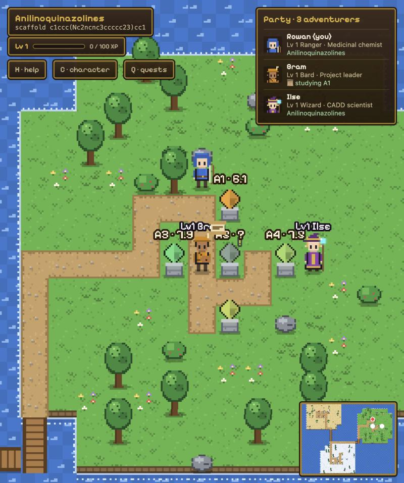
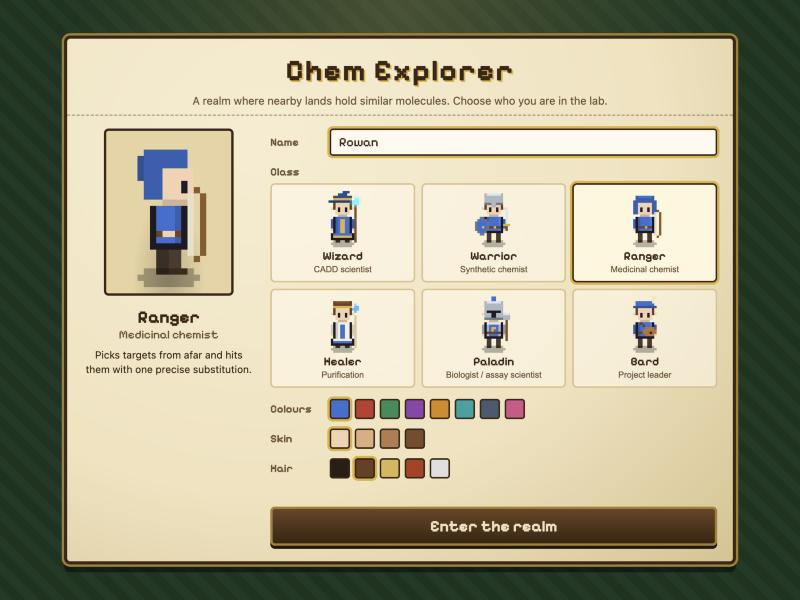
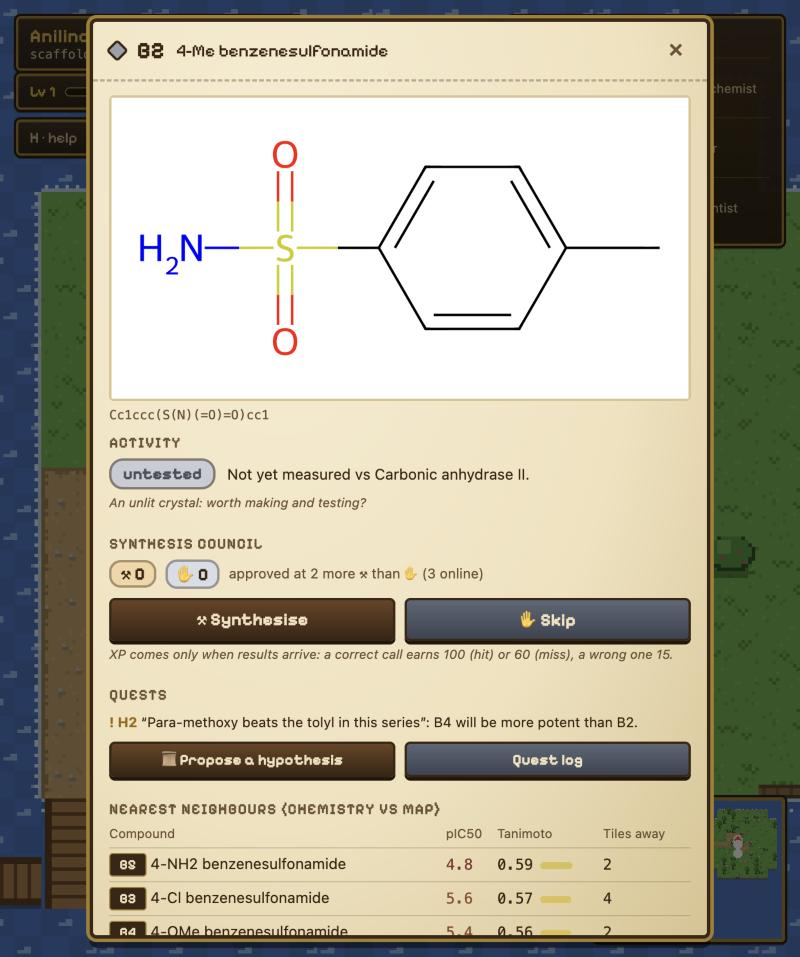
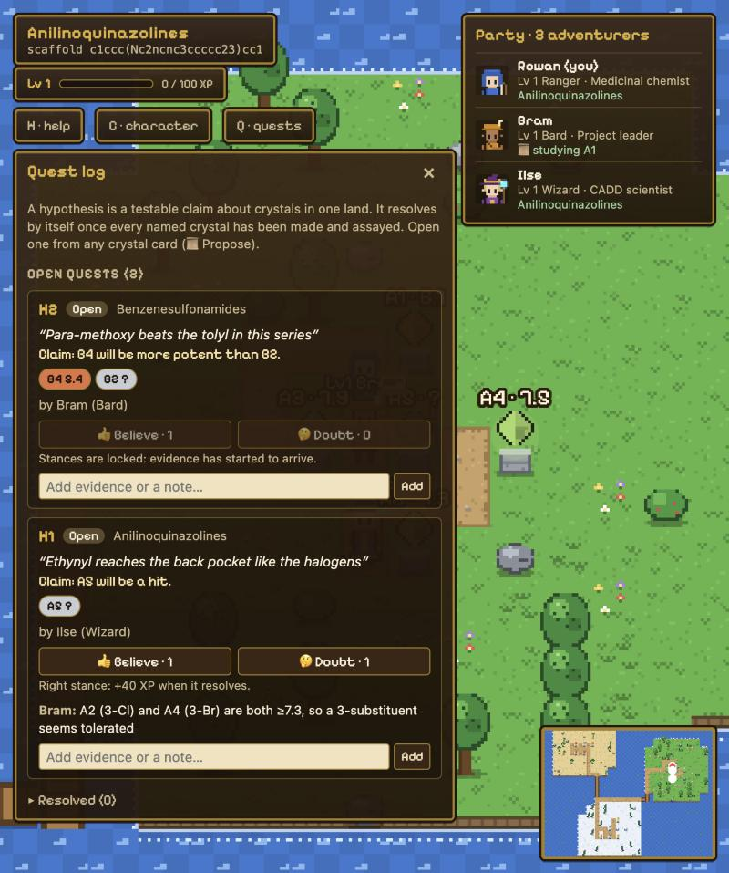
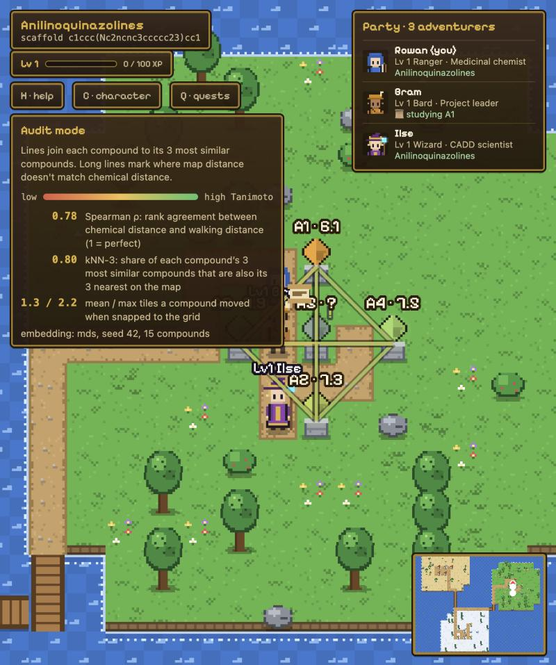

# Chem Explorer

A multiplayer, Zelda-style overworld of **chemical space**. Compounds are
crystals on a pixel-art map, laid out so that **nearby crystals are chemically
similar**. Each land is one scaffold. Players walk the map together, vote on
which untested compounds the lab should make, propose hypotheses as quests, and
level up only when their calls turn out right.



| Create your hero | Vote on what the lab makes |
|---|---|
|  |  |
| **Hypotheses as quests** | **Audit mode: is the map honest?** |
|  |  |

- **Explore:** walk the lands (meadow, desert, tundra), open any crystal to see
  its structure (RDKit.js), properties, potency and nearest neighbours.
- **Synthesis council:** vote ⚒ *synthesise* or ✋ *skip* on grey (untested)
  crystals. Approved ones are made, assayed and revealed to everyone.
- **Hypotheses as quests:** claim "these crystals will all be hits" or "A will
  beat B". The quest resolves itself when the results arrive.
- **RPG classes = lab roles:** Wizard (CADD), Warrior (synthetic chemist),
  Ranger (medicinal chemist), Healer (purification), Paladin (biologist / assay),
  Bard (project leader). Each class unlocks skills at levels 2 and 4.
- **Outcome-based XP:** no points for clicking around, only for correct calls
  and resolved hypotheses.
- **Honest geography:** audit mode (T) shows where map distance and chemical
  distance disagree.

> The potency values in the demo data are **illustrative**, not literature
> measurements.

## Requirements

| Tool | Version | Needed for |
|---|---|---|
| [Node.js](https://nodejs.org) + npm | 20 or newer (developed on 22) | the game client and server |
| Python + [uv](https://docs.astral.sh/uv/) | Python 3.12 | *optional:* rebuilding the map from your own compounds |

A modern browser with WebGL (Chrome, Firefox, Safari, Edge).

## Quick start

```bash
git clone https://github.com/pawulon-tpd/chem-explorer.git
cd chem-explorer
npm --prefix server install
npm --prefix client install
```

Start the multiplayer server (terminal 1):

```bash
npm --prefix server run dev
```

Start the game client (terminal 2):

```bash
npm --prefix client run dev
```

Open **http://localhost:5173**, create your hero and press **Enter the realm**.

- **Playing together on one network:** others open `http://<your-computer's-IP>:5173`.
  The client connects to the server on port 2567 of the same host.
- **No server running?** The game still works, solo: you can explore and read
  crystals, but voting, quests and XP need the server.

## Controls

| Key | Action |
|---|---|
| Arrows / WASD | walk |
| Space / Enter | study the crystal you're facing |
| Click a crystal | study it from anywhere |
| Q | quest log: hypotheses |
| C | character sheet: level, skills, calibration |
| T | audit mode: is the geography honest? |
| H | help |
| Esc | close a card or panel |

## Configuration

**Server** (`server/`), set as environment variables:

| Variable | Default | Purpose |
|---|---|---|
| `PORT` | `2567` | WebSocket port |
| `LAB_SPEED` | `1` | `10` makes synthesis + assay take 6 s instead of 60 s (good for demos) |
| `WORLD_JSON` | `../client/public/world.json` | the map |
| `ASSAY_RESULTS` | `data/assay-results.json` | hidden results revealed after synthesis |
| `PROGRESS_JSON` | `data/progress.json` | saved XP, votes, quests |

```bash
LAB_SPEED=10 npm --prefix server run dev
```

Reset all progress (stop the server first):

```bash
npm --prefix server run reset
```

**Client:** set `VITE_SERVER_URL` at build time to point at a server on
another host, e.g. `VITE_SERVER_URL=wss://my-server.example.com`.

## Build and deploy

```bash
npm --prefix client run build
```

The static site lands in `client/dist/` with relative paths, so it can be
hosted anywhere, including GitHub Pages. Without a reachable server it runs in
solo mode. For multiplayer, run `server/` on any Node host (e.g. Fly.io,
Render, Colyseus Cloud) and build the client with `VITE_SERVER_URL`.

## Use your own compounds

The map is generated from an SDF by a Python pipeline (RDKit, Morgan
fingerprints, Tanimoto distances, embedding, tile assignment). `world.json`
is committed, so you only need this to change the compounds.

```bash
uv venv pipeline/.venv --python 3.12
uv pip install --python pipeline/.venv -r pipeline/requirements.txt
pipeline/.venv/bin/python pipeline/build_world.py --sdf path/to/your.sdf --remap
```

Each SDF record needs an `ID` tag. Optional tags: `SERIES`, `NAME`, `MW`,
`cLogP`, `TPSA`, `HBD`, `HBA`, `TARGET`, `pIC50` (omit `pIC50` for untested
compounds). For larger sets use `--method umap` and a bigger `--grid` (each
compound needs about 4 tiles, so 1,000 compounds need roughly 70x70). See
[pipeline/README.md](pipeline/README.md) for every option.

## Project layout

```
client/     Phaser 3 + Vite + TypeScript game (procedural pixel art, RDKit.js)
server/     Colyseus multiplayer server: movement, council, lab, XP, quests
shared/     game rules shared by client and server (XP, quorum, skills, claims)
pipeline/   Python: SDF -> world.json
data/       demo compounds (3 series x 5 analogues)
docs/       design notes
```

## Documentation

- [docs/council-and-progression.md](docs/council-and-progression.md): voting, lab loop, XP, skills, hypotheses
- [game-concept.md](game-concept.md): the idea and why a map
- [prototype-plan.md](prototype-plan.md): the original prototype plan
- [client/README.md](client/README.md), [server/README.md](server/README.md), [pipeline/README.md](pipeline/README.md)
